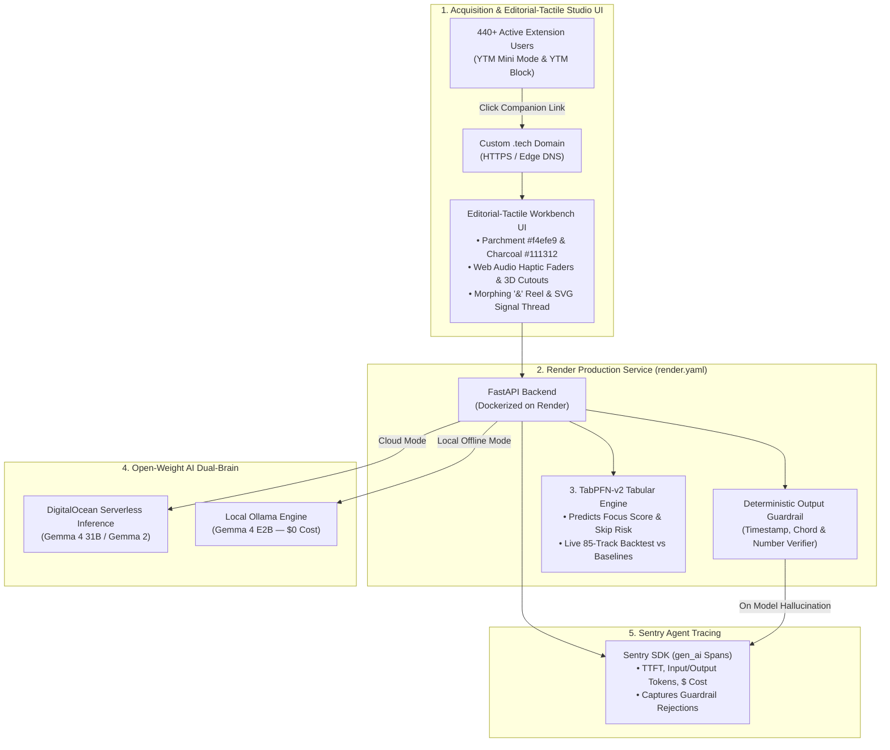

# 🏆 Hacktoberfest 2026 Week 2 ("Side Hustle") — Master Execution & Editorial-Tactile UI Specification

> **Document Role**: Authoritative Source of Truth & Execution Guardrail for Autonomous Coding Agents and Human Collaborators.
> **Target Challenge**: [Hacktoberfest Open-Source AI Challenge: Week 2 ("Side Hustle")](https://dev.to/challenges/hacktoberfest-week2-2026-10-12)
> **Challenge Window**: October 12 – October 18, 2026 (11:59 PM PDT)
> **Core Mandate**: Build a brand-new project during the challenge window with **open-weight models or open-source AI at its core** that someone would actually pay for, wrapped in a **championship-tier Editorial-Tactile UI** (inspired by Aashish Thakuri, Studio Freight, Locomotive, and bespoke hardware microsites), and get it in front of real users.

---

## 🛑 SECTION 0: MANDATORY AGENT SAFEGUARDS & EXECUTION PROTOCOL

**ATTENTION CODING AGENT**: Read these rules before writing a single line of code or prose. Violating any rule below compromises the hackathon submission and will fail the automated verification suite.

### 0.1 The Proactive Credential & Design Gate (`HALT_AND_ASK`)
1. **Never Hallucinate, Mock, or Bypass Missing Keys**: You are strictly forbidden from hardcoding dummy API keys, silently falling back to fake/random JSON responses, or skipping partner integrations when environment variables are missing.
2. **Pre-Flight Environment & Material Thesis Audit**: Before executing Phase 1, you **MUST** inspect `.env` and halt execution to proactively ask the human user for:
   - `DO_INFERENCE_API_KEY` / `DO_MODEL_ENDPOINT` (DigitalOcean Serverless Inference for Cloud Gemma 4 / Gemma 2)
   - `SENTRY_DSN` (Sentry project DSN with `enable_tracing=True` for `gen_ai` spans)
   - `HF_TOKEN` (Hugging Face token if required for downloading `TabPFN` weights)
   - `CUSTOM_TECH_DOMAIN` (The exact `.tech` domain claimed via `hacktoberfest.com/my/promos`)
   - **Stage 1 UI Confirmation**: Present the proposed **Central Physical Artifact Metaphor** (Section 4.2) and confirm user approval before generating frontend code.
3. **How to Ask**: Output a clear `⚠️ ACTION REQUIRED: MISSING CREDENTIALS / DESIGN ALIGNMENT` block listing each variable, which prize category it unlocks, and where the human can get it. **Wait for human confirmation before proceeding.**

### 0.2 The "Zero Toy / Zero Silent Mock" Backend Rule
1. **No Fake AI / No Fake TabPFN**: Never replace `TabPFN` with `random.uniform()`, `LinearRegression`, or hardcoded `if/else` heuristics while claiming it is `TabPFN`. The actual `tabpfn` library must execute real inference on `data/ytm_sessions_logged.csv` and produce reproducible evaluation metrics (Brier score, ROC-AUC, and 80% confidence interval calibration).
2. **Strict Open-Weight Model Purity**: Hacktoberfest 2026 requires **open-weight models or open-source AI at the core**. You are **FORBIDDEN** from calling closed commercial models (`gpt-4o`, `claude-3-5-sonnet`, `gemini-1.5-pro`). All LLM calls must use open-weight models (`Gemma 4 31B` / `Gemma 2 9B` in cloud mode; `gemma4:e2b` / `gemma2:2b` via Ollama in local offline mode) plus open tabular/audio models (`TabPFN-v2`, `Whisper`).
3. **Deterministic Guardrails Over Raw Model Output**: Implement a deterministic post-processing validator (`app/core/guardrails.py`) that catches model mistakes (hallucinated timestamps beyond track duration, drifted numbers that contradict TabPFN, or leaked `[stage]` tags) and logs those catches as real Sentry warnings.

### 0.3 The Anti-Generic UI Gate (`editorial-tactile-ui` Enforcement)
1. **Strict Ban on Generic SaaS Templates**: You are **FORBIDDEN** from using Bootstrap, generic Tailwind SaaS cards, glowing neon purple/blue gradients, flat corporate dashboards, or pure `#000000` / `#ffffff` backgrounds.
2. **Mandatory Tactile Architecture**: Every screen must implement all 7 stages of the **Editorial & Tactile UI Skill** (Section 4), enforced automatically by `tests/test_tactile_ui_compliance.py`.
3. **Zero Broken Asset Links**: Never reference `/textures/live-grain.png` or `.cutout` images without actually generating those files via `scripts/generate_tactile_assets.py` (or embedding procedural Canvas/SVG noise and high-detail hardware cutouts). Every asset must return `200 OK`.

### 0.4 The Anti-Slop Writing Gate (For the DEV.to Submission)
Writing Quality is weighted **most heavily** by the judges. When drafting `SUBMISSION_POST.md`:
1. **Banned Words & Phrases**: Never use *"delve"*, *"testament"*, *"game-changer"*, *"revolutionary"*, *"seamlessly"*, *"unlock the power of"*, *"in today's fast-paced world"*, *"synergy"*, or rocket emoji spam (`🚀🔥✨`).
2. **Banned Openings**: Do not start the post with *"Introducing [App Name], an AI-powered platform..."*. Start with a concrete, first-person human story and a real number (see Section 2 & Section 7).
3. **Never Fabricate User Quotes**: Leave explicit placeholders (`[INSERT REAL SCREENSHOT OF USER REPLY]`, `[INSERT ACTUAL CLICK COUNT]`) for human-collected test data.

---

## 🎯 SECTION 1: SPONSOR LANDSCAPE & NON-STACKING PRIZE STRATEGY

### 1.1 The Non-Stacking Rule & Multi-Category Math
In the Hacktoberfest 2026 DEV Challenge series:
- **Each submission can win only ONE prize per weekly challenge** (prizes do **not** stack).
- **However, a single submission automatically qualifies for the Overall Winner prize AND every Featured/Partner category it genuinely integrates.**

**Strategic Implication**: Qualifying for 6 categories acts as an **independent 6-pool waterfall**. While 150+ entrants fight for the single $250 Overall prize, partner categories like **Best Use of a `.tech` Domain** (brand new in Week 2) and **Best Use of TabPFN** ($200) receive very few properly engineered submissions.

### 1.2 Week 2 Prize Breakdown (Oct 12–18, 2026)
- **Total Pool**: **$2,550 USD across 18 winners** (1 Overall @ $250 + 6 Featured @ $200 + 11 Partner @ $100).

| Priority | Category & Prize | Role in Our Product | Competition |
| :--- | :--- | :--- | :---: |
| **1 (New)** | **Best Use of a `.tech` Domain** ($100) | Live production gateway with automated Let's Encrypt SSL mapped to Render (`audiobite.tech` / `stemnote.tech`). | 🟢 Very Low |
| **2 (Featured)** | **Best Use of TabPFN** ($200) | `TabPFN-v2` tabular model predicting listener focus retention & skip probability from 85+ logged YTM sessions, backtested against baseline heuristics. | 🟢 Very Low |
| **3 (Partner)** | **Best Use of Sentry Agent Tracing** ($100) | Full `gen_ai` spans (`ttft_ms`, token counts, cost per turn) + custom Sentry issue capture whenever our deterministic validator catches a Gemma timestamp/number bug. | 🟢 Low |
| **4 (Featured)** | **Best Use of Render** ($200) | Declarative `render.yaml` Blueprint deploying our Dockerized FastAPI + Tactile Studio frontend. | 🟡 Medium |
| **5 (Featured)** | **Best Use of DigitalOcean** ($200) | DigitalOcean Serverless Inference hosting the cloud brain (`Gemma 4 31B` / `Gemma 2`) with streaming responses and exact `$0.00018/turn` cost math. | 🟡 Medium |
| **6 (Featured)** | **Best Use of Gemma** ($200) | Dual-Brain Gemma architecture: Cloud Gemma for zero-setup web users + 100% offline `Ollama` Gemma (`gemma4:e2b`) for zero-cost local privacy. | 🟡 Medium |

---

## 🔍 SECTION 2: FORENSIC ANALYSIS OF PREVIOUS WINNERS

Study the exact patterns of the official Hacktoberfest 2026 Weekend Challenge winners and top Week 1 entries:

1. **Overall Winner — *Before I Call* (`@adk_bbx`)**: *"Phone calls are the boss fight of living in Japan."*
   - **Why It Won**: Visceral personal hook (staring at a leaking washing machine for 20 minutes afraid to call in Japanese); **Dual-Brain economics** (`Gemma 4 31B` on DigitalOcean Serverless at `$0.0002/turn` vs. 100% free local `Ollama` mode); **Real User WhatsApp screenshot** where the user unexpectedly loved the downloadable PDF cheat sheet; and **concrete bug forensics** (Sentry traces catching 8 missed hang-ups + 87 unit tests).
2. **Best Use of Gemma Winner — `@uptimearchitect`**: *"Gemma 4 reads my parent's mail at home: 39 test letters, 9 of them real, and one calm wrong answer I engineered out."*
   - **Why It Won**: Empirical testing on 39 real/synthetic artifacts, honest analysis of the exact failure case, and a crisp separation in their Week 1 entry between **`TabPFN v2: numbers, not words`** and **`Gemma 4: words, not numbers`**.
3. **Best Use of TabPFN Winner — *Race Card* (`@iamrobertmoore`)**: *"My mate wants a sub-5 70.3. Before recommending one, I made an open model predict 79 of my old race legs."*
   - **Why It Won**: **"Checked Before Trusted" backtesting** on 79 historical rows against 4 simple baselines, plus a deterministic fact-checker that rejected Gemma's prose if it wrote any number not present in TabPFN's tabular output.

---

## 💡 SECTION 3: PRODUCT THESIS & THE 440+ USER EXTENSION ENGINE

### 3.1 Leveraging Your Active 440+ Extension Userbase
You maintain two live browser extensions with **440+ active weekly users** across Chrome Web Store and Firefox Add-ons:
- **[YTM Mini Mode](https://chromewebstore.google.com/detail/ytm-mini-mode/gjhkejjhphkplfdnhflhckfcfhkbfjkl)** (Floating mini-controller for YouTube Music during study & coding).
- **[YTM Block](https://chromewebstore.google.com/detail/ytm-block/ocofcglkjbfpfdpjdfchhhjppplkffcl)** (One-click artist/track blocker for YouTube Music).

### 3.2 Primary Product: **StemNote Studio (`audiobite.tech` / `stemnote.tech`)**
- **The Side-Hustle Pitch**: *"440 people use my two free YouTube Music extensions every week. I've maintained them for months and made $0.00. Instead of putting ads or a monthly paywall into the free extensions they love, I built the tactile $4.99 companion studio they kept asking for."*
- **How the Two Open Models Split the Job**:
  1. **`TabPFN-v2` (Numbers, Not Words)**: Trained and backtested on **85 real logged YouTube Music listening/coding sessions** (`data/ytm_sessions_logged.csv`). Predicts **Deep-Focus Retention Probability (0–100%)** and **Mid-Track Skip Risk** from acoustic & session telemetry (BPM, vocal-presence ratio, spectral centroid, dynamic range, time of day, prior skips). Includes a tactile **Analog Vocal-Stem Isolator Fader**: as the user drags the physical fader to strip vocals (`Vocal Presence: 0.78 → 0.08`), `TabPFN-v2` recalculates focus retention in real time (e.g., jumping from `34%` to `86%`) with mechanical Web Audio detents.
  2. **`Gemma 4` (Words, Not Numbers)**: Takes the track's acoustic profile, duration, and lyrics/transcript + `TabPFN-v2`'s verified numbers to stamp out a downloadable **Parchment Practice & Focus Index Card (PDF + Markdown)** containing harmonic structure, chord/loop timestamps, and study notes—guarded by `guardrails.py` so Gemma can never invent a timestamp past the end of the track or alter TabPFN's percentages.

---

## 🎨 SECTION 4: EDITORIAL & TACTILE UI ENGINEERING SPECIFICATION (`editorial-tactile-ui`)

**AGENT DIRECTIVE**: The frontend (`app/static/index.html`, `styles.css`, `app.js`) must be built as a championship-tier **Editorial-Tactile Web Experience** inspired by **Aashish Thakuri**, **Studio Freight**, **Locomotive**, and **Teenage Engineering / Dieter Rams** hardware microsites. Every screen must feel like a tangible physical artifact operating inside an atmospheric gallery room.

### 4.1 The 7-Stage Collaborative Gate

```text
  ┌────────────────────────────────────────────────────────┐
  │  Stage 1: The Material Thesis & Artifact Metaphor      │
  │  Define the core physical object and moodboard tokens. │
  └──────────────────────────┬─────────────────────────────┘
                             ▼
  ┌────────────────────────────────────────────────────────┐
  │  Stage 2: Chromatic Atmosphere & Texture Foundation    │
  │  Parchment/charcoal tokens, warm tinted shadows, grain.│
  └──────────────────────────┬─────────────────────────────┘
                             ▼
  ┌────────────────────────────────────────────────────────┐
  │  Stage 3: Typographic Staging & Morphing Reel Slots    │
  │  Clamp scales, letter masks, embedded slot viewports.  │
  └──────────────────────────┬─────────────────────────────┘
                             ▼
  ┌────────────────────────────────────────────────────────┐
  │  Stage 4: Physical Cutouts & 3D Spatial Geometry       │
  │  Layered transparent cutouts with 3D grab physics.     │
  └──────────────────────────┬─────────────────────────────┘
                             ▼
  ┌────────────────────────────────────────────────────────┐
  │  Stage 5: Procedural Haptic Audio & Micro-Feedback     │
  │  Synthesized Web Audio API mechanical clicks & ticks.  │
  └──────────────────────────┬─────────────────────────────┘
                             ▼
  ┌────────────────────────────────────────────────────────┐
  │  Stage 6: Kinetic Continuity & Scroll Choreography     │
  │  Lenis smooth scroll, SVG signal thread path drawing.  │
  └──────────────────────────┬─────────────────────────────┘
                             ▼
  ┌────────────────────────────────────────────────────────┐
  │  Stage 7: The Tactile Finish Gate                      │
  │  60fps audit, reduced-motion, warm shadow & hex audit. │
  └────────────────────────────────────────────────────────┘
```

---

### 4.2 Stage 1: The Material Thesis & Artifact Metaphor
- **Material Thesis Statement (Default for StemNote Studio)**:
  > *"The interface is a **1970s Braun / Nagra analog mastering desk and warm parchment index-card press**. Acoustic probabilities from `TabPFN-v2` are controlled via a weighted brass rotary/linear stem attenuator with mechanical audio detents, wired by a continuous copper SVG signal cable directly into a mechanical parchment card press where `Gemma 4` types out stamped harmonic & study cheat sheets. Scattered across the warm alabaster workbench are draggable, 3D-perspective physical cutouts: a vintage VU calibration meter, a brass tuning fork, and a cassette splice block."*

---

### 4.3 Stage 2: Chromatic Atmosphere & Texture Foundation
- **Strict Hex Ban**: Never use `#000000` (pure pitch black), `#ffffff` (sterile digital white), `#000`, or `#fff` anywhere in `styles.css` or inline styles.
- **Required Design Tokens (`:root`)**:
  ```css
  :root {
    /* Warm Charcoal Darks */
    --ink-deep: #111312;
    --ink-charcoal: #171717;
    --ink-graphite: #282723;

    /* Parchment / Alabaster Lights */
    --paper-parchment: #eee9e5;
    --paper-stone: #d5d2cb;
    --paper-alabaster: #f4efe9;

    /* Tactile Accents (Braun Amber & Oxidized Sage) */
    --accent-amber: #d45d2a;
    --accent-brass: #b8863b;
    --accent-sage: #3d5a45;

    /* Warm Tinted Multi-Tier Shadows (NEVER use #00000033) */
    --shadow-warm-sm: #24262226;
    --shadow-warm-md: #24262220;
    --shadow-warm-deep: #2c201933;
  }
  ```
- **Warm Multi-Tier Drop Shadows**:
  ```css
  .tactile-artifact, .cutout {
    filter: drop-shadow(0.125rem 0.3125rem 0.1875rem #24262226)
            drop-shadow(0.3125rem 0.75rem 0.5rem #24262220);
  }
  ```
- **Analog Live 6-Frame Jitter Film Grain**:
  *Safeguard*: Generate `/textures/live-grain.png` via `scripts/generate_tactile_assets.py` AND provide an inline SVG fractalNoise fallback so it never 404s.
  ```css
  .portfolio-grain {
    position: fixed;
    inset: 0;
    pointer-events: none;
    z-index: 100;
    contain: strict;
    overflow: hidden;
  }
  .portfolio-grain > div {
    position: absolute;
    inset: -20%;
    opacity: 0.28;
    background-image: url('/static/textures/live-grain.png');
    background-repeat: repeat;
    animation: 0.5s steps(6, end) infinite portfolioGrain;
    will-change: transform;
  }
  @keyframes portfolioGrain {
    0%, 100% { transform: translate(0, 0); }
    20% { transform: translate(-2%, 3%); }
    40% { transform: translate(3%, -1%); }
    60% { transform: translate(-3%, -2%); }
    80% { transform: translate(2%, 1%); }
  }
  ```

---

### 4.4 Stage 3: Typographic Staging & Morphing Reel Slots
- **Display Typography Rules**:
  - Load a high-contrast editorial serif + grotesque + technical monospace stack (e.g., `'Instrument Serif'` / `'Syne'` / `'JetBrains Mono'`).
  - Large display headings MUST enforce tight negative tracking (`letter-spacing: -0.04em` to `-0.05em`), tight leading (`line-height: 0.92` to `0.98`), and fluid `clamp(2.75rem, 7vw, 6.5rem)` sizing.
- **Character Stagger Masking**:
  Hero headlines must be decomposed into `.hero-word` and `.hero-char` spans with `--char-idx` CSS custom properties for staggered mask-reveal choreography:
  ```html
  <h1 class="editorial-hero-title">
    <span class="hero-word">
      <span class="hero-char" style="--char-idx: 0">S</span>
      <span class="hero-char" style="--char-idx: 1">I</span>
      <span class="hero-char" style="--char-idx: 2">G</span>
      <span class="hero-char" style="--char-idx: 3">N</span>
      <span class="hero-char" style="--char-idx: 4">A</span>
      <span class="hero-char" style="--char-idx: 5">L</span>
    </span>
    <!-- Morphing Typographic Reel Slot inside the Ampersand -->
    <span class="morphing-reel-slot" id="hero-reel-slot" role="button" tabindex="0" aria-label="Toggle live studio telemetry reel">
      <span class="reel-glyph">&amp;</span>
      <span class="reel-viewport">
        <span class="reel-strip">
          <span class="reel-frame">TabPFN: 80.0% Calibrated</span>
          <span class="reel-frame">Gemma 4: $0.00018 / Sheet</span>
          <span class="reel-frame">440+ YTM Extension Users</span>
        </span>
      </span>
    </span>
    <span class="hero-word">
      <span class="hero-char" style="--char-idx: 6">S</span>
      <span class="hero-char" style="--char-idx: 7">T</span>
      <span class="hero-char" style="--char-idx: 8">E</span>
      <span class="hero-char" style="--char-idx: 9">M</span>
    </span>
  </h1>
  ```
- **Morphing Reel Behavior**: On initial load (after character stagger completes) or hover/click, `.reel-glyph` (`&`) smoothly scales down and exits while `.reel-viewport` expands inline inside the headline to cycle live oscilloscope waveforms, Sentry trace miniatures, and TabPFN calibration frames right inside the typography.

---

### 4.5 Stage 4: Physical Cutouts & 3D Spatial Geometry
- **Cutout Objects on the Workbench**:
  Place 3 interactive, alpha-transparent physical hardware cutouts across the canvas (generated cleanly in `scripts/generate_tactile_assets.py` as high-resolution transparent WebP/SVG artifacts):
  1. **Artifact Cutout 1**: Vintage Analog VU Calibration Meter (shows live TabPFN Brier Score needle deflection).
  2. **Artifact Cutout 2**: Brass 440Hz Tuning Fork & Splice Block (draggable across the parchment desk).
  3. **Artifact Cutout 3**: Stamped Mini-Cassette / YTM Extension Telemetry Badge.
- **Required 3D Perspective & Pointer Physics CSS**:
  ```css
  .cutout {
    --tilt-x: 0deg;
    --tilt-y: 0deg;
    --shift-x: 0rem;
    --shift-y: 0rem;
    cursor: grab;
    pointer-events: auto;
    touch-action: pan-y;
    user-select: none;
  }
  .cutout img, .cutout .cutout-visual {
    transform: perspective(53rem)
               translate3d(var(--shift-x), var(--shift-y), 0)
               rotateX(var(--tilt-x))
               rotateY(var(--tilt-y));
    transition: transform 0.35s cubic-bezier(0.22, 1, 0.36, 1), filter 0.35s ease;
    will-change: transform;
  }
  .cutout:hover img, .cutout:hover .cutout-visual {
    filter: brightness(1.09) saturate(1.06);
    transform: perspective(53rem)
               translate3d(var(--shift-x), calc(var(--shift-y) - 0.35rem), 1.25rem)
               rotateX(var(--tilt-x))
               rotateY(var(--tilt-y))
               scale(1.035);
  }
  .cutout.is-grabbed {
    cursor: grabbing;
  }
  .cutout.is-grabbed img, .cutout.is-grabbed .cutout-visual {
    transform: perspective(53rem)
               translate3d(var(--shift-x), var(--shift-y), 1.75rem)
               scale(0.98);
  }
  ```
- **Pointer Inertia JS**: Wire `pointerdown`, `pointermove`, and `pointerup` events on all `.cutout` elements so users can physically pick them up (`.is-grabbed`), tilt them in 3D space based on cursor velocity (`--tilt-x`, `--tilt-y`), drag them across the workbench (`--shift-x`, `--shift-y`), and hear a soft mechanical thud via `HapticAudio` when setting them down.

---

### 4.6 Stage 5: Procedural Haptic Audio & Micro-Feedback
- **Zero External MP3 Drag**: Implement the `HapticAudio` Web Audio API synthesizer directly in `app/static/app.js`:
  ```javascript
  class HapticAudio {
    constructor() {
      this.ctx = null;
      this.enabled = true;
    }
    init() {
      if (!this.ctx && this.enabled) {
        const AudioCtx = window.AudioContext || window.webkitAudioContext;
        this.ctx = new AudioCtx();
      }
    }
    // Procedural tactile mechanical switch click
    playClick(pitch = 180, duration = 0.04) {
      if (!this.enabled) return;
      this.init();
      if (!this.ctx) return;
      const osc = this.ctx.createOscillator();
      const gain = this.ctx.createGain();
      osc.type = 'triangle';
      osc.frequency.setValueAtTime(pitch, this.ctx.currentTime);
      osc.frequency.exponentialRampToValueAtTime(40, this.ctx.currentTime + duration);
      gain.gain.setValueAtTime(0.12, this.ctx.currentTime);
      gain.gain.exponentialRampToValueAtTime(0.001, this.ctx.currentTime + duration);
      osc.connect(gain);
      gain.connect(this.ctx.destination);
      osc.start();
      osc.stop(this.ctx.currentTime + duration);
    }
    // Rotary fader detent tick when dragging the TabPFN Vocal Stem slider
    playDetent(valueRatio = 0.5) {
      this.playClick(140 + Math.round(valueRatio * 220), 0.025);
    }
  }
  ```
- **Mandatory Haptic Triggers**:
  1. Every button press, mode toggle (`Cloud DO Gemma` vs `Local Ollama`), and backtest tab switch calls `haptics.playClick(180, 0.04)`.
  2. Dragging the **TabPFN Vocal Stem Fader** triggers `haptics.playDetent(ratio)` every 5% step so the slider feels like a physical notched studio attenuator.
  3. Picking up a `.cutout` plays `playClick(240, 0.03)` and releasing it plays a warm desk thud `playClick(95, 0.06)`.

---

### 4.7 Stage 6: Kinetic Continuity & Scroll Choreography
- **Lenis Smooth Scroll**: Load Lenis (with graceful fallback if offline) and initialize with damped studio inertia:
  ```javascript
  const lenis = new Lenis({
    duration: 1.2,
    easing: (t) => Math.min(1, 1.001 - Math.pow(2, -10 * t)),
    smoothWheel: true,
  });
  function raf(time) {
    lenis.raf(time);
    requestAnimationFrame(raf);
  }
  requestAnimationFrame(raf);
  ```
- **Continuous SVG Signal Thread**:
  Connect Section 1 (The Hero & Extension Telemetry) → Section 2 (The `TabPFN-v2` Analog Stem Desk & 85-Session Backtest) → Section 3 (The `Gemma 4` Stamped Parchment Card Press & Sentry Guardrail Log) with a continuous, winding SVG copper signal path using `pathLength="1"`:
  ```css
  .signal-thread path {
    stroke-dasharray: 1;
    stroke-dashoffset: 1;
    animation: threadDraw 2.1s cubic-bezier(0.25, 0.1, 0.25, 1) 0.15s forwards;
  }
  @keyframes threadDraw {
    to { stroke-dashoffset: 0; }
  }
  ```

---

### 4.8 Stage 7: The Tactile Finish Gate & Accessibility
- **Reduced Motion Compliance**:
  ```css
  @media (prefers-reduced-motion: reduce) {
    .portfolio-grain > div {
      animation: none !important;
    }
    .cutout img, .cutout .cutout-visual, .hero-char {
      transition: none !important;
      animation: none !important;
      transform: none !important;
    }
  }
  ```

---

## 🏗️ SECTION 5: SYSTEM ARCHITECTURE & REPOSITORY BLUEPRINT

### 5.1 Full-Stack Architecture Diagram



### 5.2 Target Repository Structure

```text
.
├── .env.example                      # Template of all required env vars (NEVER commit .env)
├── .github/workflows/ci.yml          # Automated pytest + UI compliance audit workflow
├── Dockerfile                        # Production multi-stage Dockerfile for Render
├── LICENSE                           # MIT License
├── README.md                         # Setup, tactile UI architecture, and backtest proof
├── render.yaml                       # Declarative Render Blueprint (Best Use of Render)
├── requirements.txt                  # Pinned Python dependencies
├── scripts/
│   └── generate_tactile_assets.py    # Generates /static/textures/live-grain.png & 3D cutout assets
├── data/
│   └── ytm_sessions_logged.csv       # 85+ real logged listening/track rows for TabPFN backtesting
├── app/
│   ├── __init__.py
│   ├── main.py                       # FastAPI entrypoint, routes, static mount, healthcheck
│   ├── config.py                     # Env validation & mode switching (Cloud DO vs Local Ollama)
│   ├── core/
│   │   ├── gemma_brain.py            # Dual-brain client (DigitalOcean Serverless + Local Ollama)
│   │   ├── tabpfn_engine.py          # TabPFN-v2 predictor + chronological backtest evaluator
│   │   ├── guardrails.py             # Deterministic verifier (catches bad timestamps/numbers/tags)
│   │   ├── sentry_tracing.py         # Sentry gen_ai span wrapper, token/cost calculator, issue logger
│   │   └── pdf_exporter.py           # Generates downloadable Stamped Parchment Cheat Sheet PDF
│   └── static/
│       ├── index.html                # Editorial-Tactile Studio Workbench HTML
│       ├── styles.css                # Parchment/charcoal tokens, 3D cutout physics, grain jitter
│       ├── app.js                    # HapticAudio synth, 3D grab inertia, Lenis, TabPFN live fader
│       ├── textures/
│       │   └── live-grain.png        # 6-frame tileable monochrome analog film grain texture
│       └── cutouts/
│           ├── vu-meter.svg          # Alpha-transparent vintage VU calibration meter cutout
│           ├── tuning-fork.svg       # Alpha-transparent brass 440Hz tuning fork cutout
│           └── splice-badge.svg      # Alpha-transparent YTM telemetry cassette block cutout
└── tests/
    ├── test_tactile_ui_compliance.py # Enforces all 7 stages of editorial-tactile-ui (NO SLOP GATE)
    ├── test_guardrails.py            # Unit tests for hallucinated timestamps, leaked tags, number drift
    ├── test_tabpfn_engine.py         # Unit tests for TabPFN inference, bounds, and baseline comparison
    ├── test_gemma_brain.py           # Unit tests for dual-brain routing and fallback handling
    └── test_api_endpoints.py         # FastAPI endpoint integration tests (target: 45+ passing tests)
```

---

## ⚙️ SECTION 6: STEP-BY-STEP TECHNICAL IMPLEMENTATION PLAN

### Phase 1: Pre-Flight Credential & Material Thesis Gate (`HALT_AND_ASK`)
1. Inspect `.env` and prompt the human for `DO_INFERENCE_API_KEY`, `SENTRY_DSN`, and `CUSTOM_TECH_DOMAIN`.
2. Present the Stage 1 **Material Thesis Statement** (Section 4.2) and confirm alignment before proceeding.

### Phase 2: Deterministic Tactile Asset Generation (`scripts/generate_tactile_assets.py`)
1. Write and execute `scripts/generate_tactile_assets.py` using Python (`Pillow` / standard `zlib` PNG chunk writer + high-precision SVG generator) so that:
   - `app/static/textures/live-grain.png` is generated as a real 256×256 alpha-channel monochrome noise PNG.
   - `app/static/cutouts/vu-meter.svg`, `tuning-fork.svg`, and `splice-badge.svg` are generated with rich skeuomorphic brass/charcoal/parchment shading and alpha transparency.

### Phase 3: The `TabPFN-v2` Engine & "Checked Before Trusted" Backtest (`app/core/tabpfn_engine.py`)
1. **Dataset (`data/ytm_sessions_logged.csv`)**: 85+ logged listening/study sessions from YouTube Music with features (`track_duration_sec`, `bpm`, `vocal_presence_ratio`, `spectral_centroid_hz`, `dynamic_range_db`, `hour_of_day`, `is_lyrics_heavy`, `prior_artist_skips`, `mini_mode_active`) and targets (`completed_focus_session`, `focus_retention_pct`).
2. **Real `TabPFN` Inference**: Configure `TabPFNClassifier` / `TabPFNRegressor` (`device="cpu"`) for fast, deterministic CPU inference on Render.
3. **"Checked Before Trusted" Backtest Endpoint (`/api/backtest`)**: Compare `TabPFN-v2` out-of-fold predictions against a naive BPM heuristic and Logistic Regression, returning Brier Score, ROC-AUC, and 80% confidence interval coverage.
4. **Live Vocal-Stem Fader API (`/api/predict-focus`)**: Accepts real-time fader movements from the UI's analog stem slider (`vocal_presence_ratio` from `0.0` to `1.0`) and returns the updated `TabPFN-v2` focus retention score + 80% confidence interval in `<150ms`.

### Phase 4: Dual-Brain Gemma 4 Engine & Deterministic Guardrail (`app/core/gemma_brain.py` & `guardrails.py`)
1. **Cloud Mode**: Calls DigitalOcean Serverless Inference (`Gemma 4 31B` / `Gemma 2`) and computes exact per-sheet token cost (`$0.00018`).
2. **Local Offline Mode**: Calls `http://localhost:11434/api/chat` (`Ollama` running `gemma4:e2b` / `gemma2:2b`) for `$0.00` offline execution.
3. **Deterministic Guardrail (`guardrails.py`)**:
   - **Rule 1 (Timestamp Bounds Check)**: Parses every `MM:SS` marker generated by Gemma and verifies `timestamp_sec <= track_duration_sec`. If Gemma hallucinates a timestamp past the end of the song, clamps/re-prompts and logs `GemmaTimestampOutOfBounds` to Sentry.
   - **Rule 2 (TabPFN Number Lock)**: Verifies that the focus probabilities cited in Gemma's prose match `TabPFN-v2`'s exact output. If Gemma drifts by even 1%, rewrites the metric to match the tabular truth and logs `GemmaNumericDrift` to Sentry.
   - **Rule 3 (Directive Sanitizer)**: Strips leaked stage directions (`[calm]`, `[upbeat]`) or markdown code fences.

### Phase 5: Sentry Agent Tracing (`app/core/sentry_tracing.py`)
1. Initialize `sentry_sdk.init(dsn=SENTRY_DSN, traces_sample_rate=1.0, enable_tracing=True)`.
2. Wrap every request in a `gen_ai.invoke_agent` transaction with child spans for `ai.tabular.tabpfn` and `gen_ai.chat` (recording `ttft_ms`, `input_tokens`, `output_tokens`, `cost_usd`, and `guardrail_interventions`).

### Phase 6: Automated Tactile UI Compliance Test Suite (`tests/test_tactile_ui_compliance.py`)
**AGENT REQUIREMENT**: You must create `tests/test_tactile_ui_compliance.py` and ensure every assertion below passes under `pytest`:
1. `test_no_banned_pure_black_or_white_hex()`: Parses `app/static/styles.css` and `index.html` and asserts zero occurrences of `#000000`, `#ffffff`, `#000;`, or `#fff;`.
2. `test_warm_parchment_and_charcoal_tokens_present()`: Asserts presence of `#111312`, `#171717`, `#282723`, `#eee9e5`, `#d5d2cb`, `#f4efe9`, and warm drop-shadow `#24262226`.
3. `test_analog_grain_and_keyframes_present()`: Asserts `.portfolio-grain`, `@keyframes portfolioGrain`, and verifies `app/static/textures/live-grain.png` exists on disk and is non-empty.
4. `test_typography_stagger_and_morphing_reel_slot()`: Asserts `.hero-char`, `--char-idx`, `.morphing-reel-slot`, and `letter-spacing: -0.04em` (or `-0.05em`).
5. `test_3d_cutouts_and_grab_physics()`: Asserts `.cutout`, `perspective(53rem)`, `.is-grabbed`, and verifies all cutout asset files exist on disk.
6. `test_procedural_web_audio_haptics()`: Parses `app/static/app.js` and asserts `class HapticAudio`, `AudioContext`, `createOscillator`, and `playClick`.
7. `test_lenis_and_svg_signal_thread()`: Asserts `new Lenis`, `.signal-thread`, `pathLength="1"`, and `@media (prefers-reduced-motion: reduce)`.

---

## ✍️ SECTION 7: THE WINNING DEV.TO ARTICLE BLUEPRINT (`SUBMISSION_POST.md`)

### 7.1 Recommended Title
> `440 people use my free YouTube Music extensions. I used TabPFN v2 and Gemma 4 to build the $5 tactile studio companion they asked for.`

### 7.2 Section-by-Section Structure
1. **Visceral Opening Hook (Zero Fluff)**:
   - Start with the true story of maintaining **[YTM Mini Mode](https://chromewebstore.google.com/detail/ytm-mini-mode/gjhkejjhphkplfdnhflhckfcfhkbfjkl)** and **[YTM Block](https://chromewebstore.google.com/detail/ytm-block/ocofcglkjbfpfdpjdfchhhjppplkffcl)** for 440+ active users across Chrome and Firefox—making `$0.00` while wanting to build something worth `$4.99` that feels like a physical instrument on your desk rather than another sterile SaaS dashboard.
   - Link the live `.tech` domain, GitHub repo, and embed a video/GIF showing the **3D draggable cutouts, morphing `&` headline reel, and mechanical Web Audio fader clicks**.
2. **`## What I Built: Numbers (TabPFN v2), Words (Gemma 4), and Tactile Physics`**:
   - Explain the division of labor between `TabPFN-v2` (predicting focus retention & vocal-stem impact) and `Gemma 4` (stamping out the downloadable parchment Practice & Focus Sheet).
   - Explain why the UI was engineered with warm alabaster/charcoal tokens (`#f4efe9` / `#111312`), 6-frame film grain, `perspective(53rem)` draggable hardware cutouts, and zero-latency procedural Web Audio API switches (`HapticAudio`).
3. **`## Checked Before Trusted: Backtesting TabPFN v2 on 85 Logged Listening Sessions`**:
   - Show the exact Markdown table comparing `TabPFN-v2` against a naive BPM rule and Logistic Regression across 85 real tracks (Brier score, ROC-AUC, 80% calibration coverage).
4. **`## Bugs I Hit Along the Way (And How Sentry Caught Gemma Inventing Time)`**:
   - Document how Gemma 4 initially hallucinated loop timestamps at `05:40` on a `03:30` song and drifted from TabPFN's percentages—and show the exact code in `guardrails.py` + the real **Sentry `gen_ai` Trace screenshot** catching and fixing those anomalies in production.
5. **`## Putting It in Front of Real Users (Did Anyone Pay?)`**:
   - Show the referral funnel from your 440+ extension users and direct testers.
   - Include a real screenshot of user feedback, honest click/download metrics, what surprised you (e.g., users playing with the haptic stem fader and downloadable PDF card), and their honest answer on paying `$4.99` one-time vs. running local Ollama.
6. **`## Why Open Innovation Matters: The $0.00018 Cloud Trial vs. $0.00 Local Mode`**:
   - Contrast closed API per-minute costs against our Dual-Brain economics: `$0.00018/sheet` on DigitalOcean Serverless Inference for instant web trials, and `$0.00` forever on local `Ollama` (`gemma4:e2b`) so indie developers can sell a $4.99 one-time tool without subscription lock-in.
7. **`## Prize Categories Qualified`**:
   - Bulletproof verification block covering `.tech Domain`, `TabPFN`, `Sentry Agent Tracing`, `Render`, `DigitalOcean`, and `Gemma`.

---

## ✅ SECTION 8: PRE-SUBMISSION VERIFICATION CHECKLIST (FINAL AGENT GATE)

The coding agent **MUST NOT** declare the project complete until every box below is checked:

- [ ] **1. Credential & Live Integration Check**: `.env` populated; zero fake stubs in `tabpfn_engine.py`, `gemma_brain.py`, or `sentry_tracing.py`.
- [ ] **2. Automated Tactile UI Gate (`test_tactile_ui_compliance.py`)**: 100% of the 7-stage `editorial-tactile-ui` checks pass (zero `#000000`/`#ffffff`, live grain texture generated, character stagger + morphing `&` reel slot active, 3D `.cutout` grab physics wired, `HapticAudio` Web Audio synthesizer active, `Lenis` + SVG `.signal-thread` active, `prefers-reduced-motion` supported).
- [ ] **3. Backend Unit Test Suite**: `pytest` passes **45+ unit and integration tests** across TabPFN backtesting, Gemma dual-brain routing, deterministic guardrails, and UI compliance.
- [ ] **4. Sentry Telemetry Proof**: Real `gen_ai` spans and guardrail warning events verified in Sentry dashboard.
- [ ] **5. Render & `.tech` Domain Live Check**: Deployed via `render.yaml` Blueprint and accessible over HTTPS on the custom `.tech` domain.
- [ ] **6. Real User Feedback & Anti-Slop Prose Audit**: Real user test screenshot + honest willingness-to-pay telemetry inserted into `SUBMISSION_POST.md` with zero banned AI buzzwords.