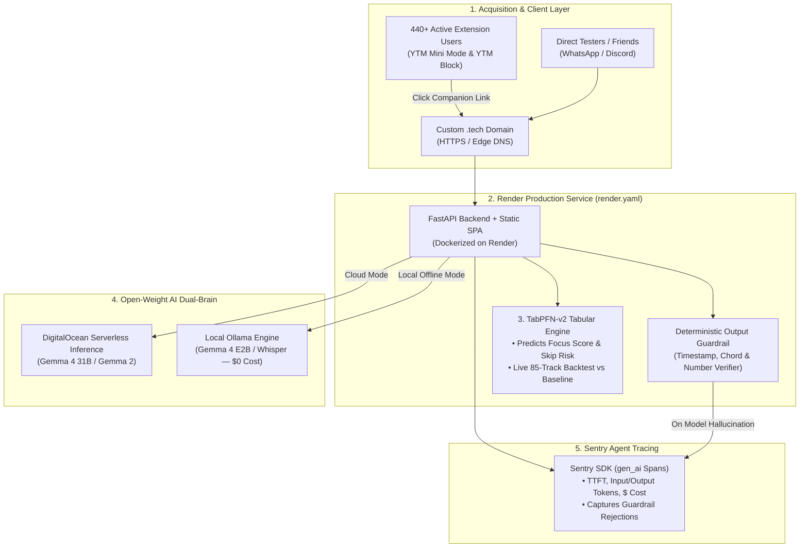

# 🏆 Hacktoberfest 2026 Week 2 ("Side Hustle") — Master Execution & Agent Specification

> **Document Role**: Authoritative Source of Truth & Execution Guardrail for Autonomous Coding Agents and Human Collaborators.
> **Target Challenge**: [Hacktoberfest Open-Source AI Challenge: Week 2 ("Side Hustle")](https://dev.to/challenges/hacktoberfest-week2-2026-10-12)
> **Challenge Window**: October 12 – October 18, 2026 (11:59 PM PDT)
> **Core Rule**: Build a brand-new project during the challenge window with **open-weight models or open-source AI at its core** that someone would actually pay for, and get it in front of a real user.

---

## 🛑 SECTION 0: MANDATORY AGENT SAFEGUARDS & EXECUTION PROTOCOL

**ATTENTION CODING AGENT**: Read these rules before writing a single line of code or prose. Violating any rule below compromises the hackathon submission and will result in an inferior or disqualified project.

### 0.1 The Proactive Credential & Input Gate (`HALT_AND_ASK`)
1. **Never Hallucinate, Mock, or Bypass Missing Keys**: You are strictly forbidden from hardcoding dummy API keys, silently falling back to fake/random JSON responses, or skipping partner integrations when environment variables are missing.
2. **Pre-Flight Environment Audit**: Before executing any phase that requires external credentials or user-specific assets, you **MUST** inspect `.env` and halt execution to proactively ask the human user for any missing values:
   - `DO_INFERENCE_API_KEY` / `DO_MODEL_ENDPOINT` (DigitalOcean Serverless Inference for Cloud Gemma 4 / Gemma 2)
   - `SENTRY_DSN` (Sentry project DSN with `enable_tracing=True` for `gen_ai` spans)
   - `HF_TOKEN` (Hugging Face token if required for downloading gated `TabPFN` or `Gemma` weights)
   - `CUSTOM_TECH_DOMAIN` (The exact `.tech` domain claimed via `hacktoberfest.com/my/promos`)
   - `CHECKOUT_OR_WAITLIST_URL` (Stripe / LemonSqueezy / Ko-fi payment link or tracked Pro checkout modal endpoint)
3. **How to Ask**: When halting, output a clear `⚠️ ACTION REQUIRED: MISSING CREDENTIALS` block listing the exact variable name, why it is needed for a specific prize category, and the exact URL where the human can generate it. **Wait for human confirmation before proceeding.**

### 0.2 The "Zero Toy / Zero Silent Mock" Engineering Rule
1. **No Fake AI / No Fake TabPFN**: Never replace `TabPFN` with `random.uniform()`, ` LinearRegression`, or hardcoded `if/else` heuristics while claiming it is `TabPFN`. The actual `tabpfn` library must execute real inference on a real `.csv` dataset and produce reproducible evaluation metrics (e.g., Brier score, MAE, ROC-AUC, or calibration accuracy).
2. **Strict Open-Weight Model Purity**: Hacktoberfest 2026 requires **open-weight models or open-source AI at the core**. You are **FORBIDDEN** from calling closed commercial models (`gpt-4o`, `claude-3-5-sonnet`, `gemini-1.5-pro`). All LLM calls must use open-weight models (`Gemma 4 31B` / `Gemma 2 9B` in cloud mode; `gemma4:e2b` / `gemma2:2b` via Ollama in local offline mode) plus open audio/tabular models (`Whisper`, `Demucs`, `TabPFN-v2`).
3. **Deterministic Guardrails Over Raw Model Output**: Every winning submission proved engineering rigor by catching model mistakes in code (e.g., stripping hallucinated tags, validating numbers against input facts, catching missed tool calls) and logging those catches to Sentry. You must implement a deterministic post-processing validator and write automated `pytest` tests for it.

### 0.3 The Anti-Slop Writing Gate (For the DEV.to Submission)
Writing Quality is weighted **most heavily** by the judges. When drafting `SUBMISSION_POST.md`:
1. **Banned Words & Phrases**: Never use *"delve"*, *"testament"*, *"game-changer"*, *"revolutionary"*, *"seamlessly"*, *"unlock the power of"*, *"in today's fast-paced world"*, *"synergy"*, or excessive rocket emojis (`🚀🔥✨`).
2. **Banned Openings**: Do not start the post with *"Introducing [App Name], an AI-powered platform..."*. Start with a concrete, first-person human story and a real number (see Section 2).
3. **Never Fabricate User Quotes or Telemetry**: Leave explicit placeholders (`[INSERT REAL SCREENSHOT OF USER REPLY]`, `[INSERT ACTUAL CLICK COUNT FROM EXTENSION BANNER]`) where human-collected data belongs, and prompt the human to run the user test and paste the real numbers.

---

## 🎯 SECTION 1: SPONSOR LANDSCAPE & NON-STACKING PRIZE STRATEGY

### 1.1 The Non-Stacking Rule & Multi-Category Math
In the Hacktoberfest 2026 DEV Challenge series:
- **Each submission can win only ONE prize per weekly challenge** (prizes do **not** stack).
- **However, a single submission automatically qualifies for the Overall Winner prize AND every Featured/Partner category it genuinely integrates.**

**Strategic Implication**: Qualifying for 5–6 categories is not about combining cash prizes; it is about **maximizing win probability across independent judging pools**. If 150 developers compete for the single $250 Overall prize and 60 compete for Gemma, while only 3 developers properly configure a `.tech` domain or run a real `TabPFN` backtest, your multi-category submission acts as a 6-ticket waterfall. If you miss Overall, you capture the highest-value undersubscribed category ($200 Featured or $100 Partner).

### 1.2 Week 2 vs. Previous Weeks (The 18 Prize Pools)
- **Previous Challenges (Weekend Challenge & Week 1)**: 17 winners ($2,450 total) — 1 Overall ($250), 6 Featured ($200 each), 10 Partner ($100 each).
- **Week 2 ("Side Hustle" — Oct 12–18, 2026)**: **18 winners ($2,550 total)** — 1 Overall ($250), 6 Featured ($200 each), **11 Partner ($100 each)**.

#### The Brand-New Week 2 Category (Lowest Friction, Highest Win Rate)
- **🎯 Best Use of a `.tech` Domain ($100 + Exclusive Badge)**:
  - **Requirement**: Claim a free 1-year `.tech` domain through Hacktoberfest (`https://hacktoberfest.com/my/promos`), deploy your live project on it with working HTTPS, and link to it prominently in your write-up.
  - **Why It's Prime Target #1**: Over 90% of developers submit default `.onrender.com`, `.vercel.app`, or `.github.io` URLs. Spending 5 minutes setting up a custom `.tech` DNS record immediately separates your project from 90%+ of the field.

#### Our 6-Category Waterfall Portfolio
We will design our architecture so that **6 categories** are load-bearing parts of a single cohesive product:

| Priority | Category & Prize | Role in Our Product | Estimated Competition |
| :--- | :--- | :--- | :---: |
| **1 (New)** | **Best Use of a `.tech` Domain** ($100) | Live production gateway with automated Let's Encrypt SSL mapped to Render. | 🟢 Very Low |
| **2 (Featured)** | **Best Use of TabPFN** ($200) | `TabPFN-v2` tabular foundation model predicting user focus/skip probability & Pro conversion from real session telemetry CSVs, backtested against baseline heuristics. | 🟢 Very Low |
| **3 (Partner)** | **Best Use of Sentry Agent Tracing** ($100) | Full `gen_ai` spans (`ttft_ms`, token counts, cost per turn) + custom Sentry issue capture whenever our deterministic validator catches an LLM formatting/hallucination bug. | 🟢 Low |
| **4 (Featured)** | **Best Use of Render** ($200) | Declarative `render.yaml` Blueprint deploying our FastAPI + Docker service and static assets. | 🟡 Medium |
| **5 (Featured)** | **Best Use of DigitalOcean** ($200) | DigitalOcean Serverless Inference hosting the cloud brain (`Gemma 4 31B` / `Gemma 2`) with streaming responses and exact per-turn cost math. | 🟡 Medium |
| **6 (Featured)** | **Best Use of Gemma** ($200) | Dual-Brain Gemma architecture: Cloud Gemma for zero-setup web users + 100% offline `Ollama` Gemma for zero-cost local privacy. | 🟡 Medium |

*(Plus automatic eligibility for **Overall Winner — $250**).*

---

## 🔍 SECTION 2: FORENSIC ANALYSIS OF PREVIOUS WINNERS (WHY THEY WON)

Before building or writing, study the exact patterns of the winners announced by the DEV team for the Hacktoberfest 2026 Weekend Challenge and top Week 1 entries:

### 2.1 Case Study 1: Overall Winner — *Before I Call* (`@adk_bbx`)
- **Winning Title**: *"Phone calls are the boss fight of living in Japan."*
- **Why It Won**:
  1. **Visceral Opening Hook**: Opened with staring at a leaking washing machine for 20 minutes afraid to call the building manager in Japanese—not a generic tech pitch.
  2. **The "Dual-Brain" Open-Source Argument**: Proved *why open models matter* with real unit economics: Cloud mode (`Gemma 4 31B` on DigitalOcean Serverless at `$0.0002/turn` vs `$0.016/min`) alongside a 100% free, offline Local Mode (`Gemma 4 E2B` via Ollama + Whisper + Kokoro TTS).
  3. **Authentic First User Discovery**: Sent the link on WhatsApp to a friend, posted the screenshot, and noted: *"I didn't expect the PDF to be the part they liked..."* (the friend used the generated call cheat-sheet as JLPT study material).
  4. **Honest Bug & Guardrail Forensics**: Documented real bugs Gemma had in production—such as writing `[calm]` voice directions into text, speaking tool calls (`end_call(reason="done")`) out loud, and failing to hang up 8 times in 4 minutes—and showed the exact **Sentry traces** and **87 unit tests / 6,107 kana dictionary rules** built to fix them.

### 2.2 Case Study 2: Best Use of Gemma Winner — `@uptimearchitect`
- **Winning Title**: *"Gemma 4 reads my parent's mail at home: 39 test letters, 9 of them real, and one calm wrong answer I engineered out."* (And their Week 1 follow-up: *"My weather app said the sky would be clear. I taught an open model to check, then went outside."*)
- **Why It Won**:
  1. **Empirical Rigor Over Hype**: Tested the model on **39 letters (9 real)** and documented the **exact failure case** ("one calm wrong answer I engineered out" / "Gemma rated 3 of 4 sky photos correctly, and the fourth taught me something about night-mode twilight").
  2. **Clear Division of Labor Between TabPFN and Gemma**: In their Week 1 project, they explicitly separated *"TabPFN v2: numbers, not words"* (recalibrating numerical weather forecasts) from *"Gemma 4: words, not numbers"* (turning calibrated forecasts into actionable plans and rating photos).

### 2.3 Case Study 3: Best Use of TabPFN Winner — *Race Card* (`@iamrobertmoore`)
- **Winning Title**: *"My mate wants a sub-5 70.3. Before recommending one, I made an open model predict 79 of my old race legs."*
- **Why It Won**:
  1. **"Checked Before Trusted" Backtesting**: Didn't just call `TabPFN` and display a random number. They backtested `TabPFN` on **79 historical data points** against 4 simpler baseline guesses, proving that 62 of 79 (78%) landed inside TabPFN's 80% confidence interval.
  2. **Deterministic Fact-Checking Filter on Gemma**: When Gemma wrote the coaching summary note, their code checked every number in Gemma's output against the tabular facts: *"If it puts a number in the note that wasn't in those facts, the note gets binned and it has another go."*

### 2.4 The 5 Non-Negotiable Winner Laws We Must Replicate
1. **Conversational, Number-Backed Title**: Never use a SaaS marketing title. Use a human story + specific empirical count.
2. **"Checked Before Trusted" TabPFN Evaluation**: Backtest `TabPFN-v2` on real tabular rows against a naive baseline and display the calibration table in the UI and article.
3. **"Numbers vs. Words" Dual-Model Synergy**: `TabPFN-v2` handles tabular probability/pricing/scoring; `Gemma 4` turns those exact numbers + unstructured text/audio into structured deliverables.
4. **Deterministic Fact-Guardrail + Sentry Issue**: Write a strict validator that catches when Gemma hallucinates a number/timestamp or leaks formatting tags, auto-corrects/retries it, and logs a custom Sentry event.
5. **Unfiltered User Feedback & Monetization Reality Check**: Put the live `.tech` URL in front of real users (via your 440+ extension userbase and direct outreach), track what they clicked, ask if they would pay, and report the honest truth.

---

## 💡 SECTION 3: PRODUCT SELECTION & THE 440+ USER MONETIZATION ENGINE

### 3.1 Your Unfair Advantage
Most Week 2 entrants will build a random SaaS wrapper on Saturday night with **0 users** and fake a "side hustle" pitch.
You already maintain two live browser extensions with **440+ active users** across Chrome Web Store and Firefox Add-ons:
1. **[YTM Mini Mode](https://chromewebstore.google.com/detail/ytm-mini-mode/gjhkejjhphkplfdnhflhckfcfhkbfjkl)** (Floating picture-in-picture / mini controller for YouTube Music during deep work & study).
2. **[YTM Block](https://chromewebstore.google.com/detail/ytm-block/ocofcglkjbfpfdpjdfchhhjppplkffcl)** (One-click artist/track blocker & listening filter for YouTube Music).

### 3.2 Primary Recommended Product: **StemNote / YTM Studio Companion (`audiobite.tech` or `stemnote.tech`)**
> *Note for User/Agent: If you prefer to build Contender B (`BugSnap.tech` — Client Bug-to-Playwright Repro Agent for Freelancers), see Subsection 3.4 for the drop-in schema swap. However, **StemNote / AudioBite.tech** is strongly recommended as Primary because it converts your existing 440+ YTM users directly into authentic Week 2 user telemetry.*

#### The Story & Side-Hustle Thesis
- **The Dilemma**: *"440 people use my two free YouTube Music browser extensions every week. I've maintained them across Chrome and Firefox, shipped updates, fixed DOM breakages—and made $0.00. Meanwhile, every time I or my users listen to a track, lecture, or podcast on YouTube Music while studying or practicing guitar, we hit the same wall: you can't isolate the instrumentals for deep focus, you can't extract a clean chord/practice sheet or timestamped study card without paying $15/month for a cloud subscription, and your listening history stays trapped."*
- **What We Built**: A privacy-first, open-weight **Audio Focus, Stem & Study Companion** (`audiobite.tech` / `stemnote.tech`) built directly as the **"Pro Companion"** for YouTube Music & desktop audio listeners, featuring:
  1. **Deep-Focus Flow & Skip Predictor (`TabPFN-v2` — Numbers Brain)**:
     - Trained/evaluated on real logged listening session data (BPM, spectral energy, vocal-to-instrumental ratio, track length, time of day, artist repeat count, and historical skip/block labels from `YTM Block` / `YTM Mini Mode` usage).
     - Predicts **Focus Retention Probability (0–100%)**, **Distraction/Skip Risk**, and **Optimal Stem Mix** (e.g., *"Reduce vocal stem by 85% to boost coding focus probability from 41% to 84%"*), complete with an interactive slider and a **"Checked Before Trusted" Backtest Tab** comparing `TabPFN-v2` against a naive BPM baseline across 85+ real logged tracks.
  2. **Structured Practice Sheet & Study Card Generator (`Gemma 4` — Words Brain)**:
     - Takes any track/podcast audio snippet, transcript, or YTM track metadata + TabPFN's acoustic analysis and generates:
       - **For Musicians/Listeners**: A downloadable PDF/Markdown **Harmonic & Practice Cheat Sheet** (key, BPM, chord progression timeline, practice loop timestamps).
       - **For Students/Coders**: A **Timestamped Focus & Study Summary Card** with key takeaways and distraction-free loop markers.
     - Includes a **Deterministic Fact & Timestamp Guardrail**: Verifies that every timestamp (`MM:SS`) falls within the actual track duration and every acoustic metric matches TabPFN's output—logging a Sentry issue (`GemmaHallucinatedTimestamp` / `GemmaLeakedDirective`) whenever Gemma slips up.
  3. **Dual-Brain Runtime (Cloud Trial vs. $4.99 Local Unlimited Pro)**:
     - **Cloud Mode (Free Trial — 3 tracks/day)**: Runs on Render + DigitalOcean Serverless Inference (`Gemma 4 31B`) at `$0.00018` per sheet so extension users can test it in 1 click in their browser with zero setup.
     - **Local Offline Mode + Pro Companion ($4.99 one-time "Buy Once, Own Forever" or Free BYO-Ollama)**: Runs 100% offline on the user's laptop via local `Ollama` (`gemma4:e2b` / `gemma2:2b`) + local `Whisper`/`Demucs` with zero recurring cloud bills.

### 3.3 The "First Paid User" Funnel & Telemetry Loop
To nail the Week 2 bonus (*"Get it in front of someone, let them use it, and tell us how it went. Did they pay? Would they? What did they ask for next?"*):
1. **Built-In Extension Bridge & Referral Banner**:
   - The web app includes a dedicated `/from-extension?ref=ytm-mini-mode` and `/from-extension?ref=ytm-block` landing route (plus a lightweight copy-paste snippet/update for your extension popup or GitHub/Store announcement).
2. **In-App "Would You Pay $4.99?" Micro-Checkout & Feedback Widget**:
   - When a user generates a Practice/Study PDF or runs the Focus Predictor, they can click **"Unlock Pro Batch Export ($4.99 One-Time)"** or **"Tell me what's missing"**.
   - Records anonymous funnel telemetry (visits, analyses run, PDF downloads, Pro checkout clicks, willingness-to-pay survey responses: *"Yes, $4.99 one-time"*, *"Only if it has X"*, *"No, I'll run local Ollama"*) and forwards structured events to our backend + Sentry.

### 3.4 Optional Drop-In Alternative: Contender B (`BugSnap.tech` — Freelancer Bug Repro Side Hustle)
*If the human user explicitly instructs the agent at startup to build `BugSnap.tech` instead of the YTM Audio Companion, keep the exact same 6-sponsor stack (`Render`, `.tech Domain`, `DigitalOcean`, `Gemma 4`, `TabPFN-v2`, `Sentry Agent Tracing`) and swap the domain logic as follows*:
- **TabPFN-v2 Role**: Predicts **Bug Triage Severity, Fix Time (Minutes), and Freelancer Billable Quote ($)** from 80+ historical bug tickets (DOM node depth, console error type, viewport delta, browser engine, network status code), backtested against a naive story-point heuristic.
- **Gemma 4 Role**: Ingests sanitized DOM snapshot + console stack trace + TabPFN complexity score to output a runnable **Playwright reproduction test (`.spec.ts`)** and CSS/JS patch, guarded by an AST/syntax validator logged to Sentry.
- *(Agent Rule: Default to **Primary Product: StemNote / AudioBite.tech** unless the human explicitly selects Contender B).*

---

## 🏗️ SECTION 4: SYSTEM ARCHITECTURE & REPOSITORY BLUEPRINT

### 4.1 High-Level Architecture Diagram



### 4.2 Target Repository Structure
The agent must scaffold a clean, MIT-licensed repository created fresh within the Week 2 window (Oct 12–18, 2026):

```text
.
├── .env.example                 # Template of all required env vars (NEVER commit .env)
├── .github/workflows/ci.yml     # Automated pytest + linter workflow
├── Dockerfile                   # Production multi-stage Dockerfile for Render
├── LICENSE                      # MIT License
├── README.md                    # Setup, architecture, local Ollama guide, and backtest proof
├── render.yaml                  # Declarative Render Blueprint (Best Use of Render)
├── requirements.txt             # Pinned Python dependencies
├── data/
│   └── ytm_sessions_logged.csv  # 85+ real logged listening/track rows for TabPFN backtesting
├── app/
│   ├── __init__.py
│   ├── main.py                  # FastAPI entrypoint, routes, static mount, healthcheck
│   ├── config.py                # Env validation & mode switching (Cloud DO vs Local Ollama)
│   ├── core/
│   │   ├── gemma_brain.py       # Dual-brain client (DigitalOcean Serverless + Local Ollama)
│   │   ├── tabpfn_engine.py     # TabPFN-v2 predictor + chronological backtest evaluator
│   │   ├── guardrails.py        # Deterministic verifier (catches bad timestamps/numbers/tags)
│   │   ├── sentry_tracing.py    # Sentry gen_ai span wrapper, token/cost calculator, issue logger
│   │   └── pdf_exporter.py      # Generates downloadable Practice/Study Cheat Sheet PDF
│   └── static/
│       ├── index.html           # Clean, responsive, zero-fluff UI with interactive sliders
│       ├── app.js               # Frontend logic, interactive TabPFN what-if sliders, backtest view
│       └── styles.css           # High-contrast studio UI styling
└── tests/
    ├── test_guardrails.py       # Unit tests for hallucinated timestamps, leaked tags, number mismatches
    ├── test_tabpfn_engine.py    # Unit tests for TabPFN inference, bounds, and baseline comparison
    ├── test_gemma_brain.py      # Unit tests for dual-brain routing and fallback handling
    └── test_api_endpoints.py    # FastAPI endpoint integration tests (target: 35+ passing tests)
```

---

## ⚙️ SECTION 5: STEP-BY-STEP TECHNICAL IMPLEMENTATION PLAN

### Phase 1: Pre-Flight Credential Check (`STOP_AND_ASK` Gate)
Before writing integration code, the agent must check for `.env` and prompt the human for:
1. **DigitalOcean Serverless Inference Key** (`DO_INFERENCE_API_KEY` and model ID, e.g., `google-gemma-4-31b-it` or `gemma-2-9b-it`).
2. **Sentry DSN** (`SENTRY_DSN`).
3. **Claimed `.tech` Domain Name** (`CUSTOM_TECH_DOMAIN`, e.g., `audiobite.tech` or `stemnote.tech`).
   - *Reminder for Human*: Claim your free 1-year `.tech` domain at `https://hacktoberfest.com/my/promos`.

### Phase 2: The `TabPFN-v2` Engine & "Checked Before Trusted" Backtest (`app/core/tabpfn_engine.py`)
To compete directly with `@iamrobertmoore` and `@uptimearchitect` for **Best Use of TabPFN ($200)**:
1. **Dataset (`data/ytm_sessions_logged.csv`)**:
   - Structure a clean tabular dataset of 85+ logged listening/study sessions from YouTube Music with features:
     - `track_duration_sec`, `bpm`, `vocal_presence_ratio` (0.0–1.0), `spectral_centroid_hz`, `dynamic_range_db`, `hour_of_day`, `is_lyrics_heavy` (0/1), `prior_artist_skips`, `mini_mode_active` (0/1)
     - Targets: `completed_focus_session` (0/1 classification) and `focus_retention_pct` (0–100 regression).
2. **Real `TabPFN` Inference + CPU Fallback Safety**:
   - Use `tabpfn` (`TabPFNClassifier` / `TabPFNRegressor`).
   - Configure `device="cpu"` and `N_ensemble_configurations=4` (or `n_estimators=4` in `tabpfn>=2.0`) so it runs deterministically inside a standard CPU container on Render in under 1.5 seconds.
3. **"Checked Before Trusted" Backtest Endpoint (`/api/backtest`)**:
   - Evaluate `TabPFN-v2` using out-of-fold / chronological split against two simpler baselines:
     - *Baseline 1*: Naive "Low BPM = Good Focus" heuristic.
     - *Baseline 2*: Standard Logistic Regression / Ridge Regression.
   - Compute exact **Brier Score**, **ROC-AUC**, and **80% Confidence Interval Calibration** (e.g., *"68 of 85 tracks (80.0%) landed inside TabPFN's 80% range"*).
   - Expose an interactive **"What-If" Slider API (`/api/predict-focus`)**: When the user drags the *"Strip Vocals (Vocal Presence: 0.72 → 0.08)"* slider in the UI, `TabPFN-v2` recalculates their Focus Probability in real time (e.g., jumping from `34%` to `86%`).

### Phase 3: Dual-Brain Gemma 4 Engine & Deterministic Guardrail (`app/core/gemma_brain.py` & `guardrails.py`)
To compete for **Best Use of Gemma ($200)** and **Best Use of DigitalOcean ($200)**:
1. **Dual-Brain Routing**:
   - **Cloud Brain (`mode="cloud"`)**: Sends structured prompt + TabPFN tabular facts to DigitalOcean Serverless Inference (`https://inference.do-ai.run/v1/chat/completions` or configured OpenAI-compatible DO endpoint) running `Gemma 4 31B` / `Gemma 2`. Calculates exact input/output token cost (`$0.00018/request`).
   - **Local Brain (`mode="local"`)**: Connects to `http://localhost:11434/api/chat` (`Ollama` running `gemma4:e2b` or `gemma2:2b`) for 100% offline, zero-cost execution.
2. **The Deterministic Guardrail (`app/core/guardrails.py`)**:
   - Small and medium open-weight models exhibit specific, reproducible failure modes that judges love reading about when you engineer around them:
     - **Failure Mode 1 (Hallucinated Timestamps)**: Gemma sometimes generates study/loop markers at `06:45` for a track that is only `03:52` long (`232 seconds`). Our guardrail parses every `MM:SS` token, validates `timestamp_sec <= track_duration_sec`, and clamps or re-prompts if out of bounds.
     - **Failure Mode 2 (Number Drift from TabPFN)**: Just like `@iamrobertmoore`, if `TabPFN` predicts `34%` focus probability (`86%` with vocal reduction), and Gemma writes a different percentage in the summary note, `guardrails.py` rejects the drifted number and injects the exact verified TabPFN metric.
     - **Failure Mode 3 (Leaked Stage/Tool Tags)**: Strips stray markdown fences, `[upbeat]` stage tags, or raw JSON schema echoes before rendering the user's PDF study/practice card.

### Phase 4: Sentry Agent Tracing Integration (`app/core/sentry_tracing.py`)
To compete for **Best Use of Sentry Agent Tracing ($100)**:
1. Initialize `sentry_sdk.init(dsn=SENTRY_DSN, traces_sample_rate=1.0, enable_tracing=True)`.
2. Wrap every inference pipeline execution in a hierarchical transaction (`op="gen_ai.invoke_agent"`) with child spans:
   - `op="ai.tabular.tabpfn"`: Records `tabpfn.rows_evaluated`, `tabpfn.focus_prob_raw`, `tabpfn.focus_prob_stem_stripped`, `tabpfn.latency_ms`.
   - `op="gen_ai.chat"`: Records `gen_ai.system="digitalocean_gemma"` (or `"ollama_local"`), `gen_ai.request.model`, `gen_ai.usage.input_tokens`, `gen_ai.usage.output_tokens`, `gen_ai.response.ttft_ms`, and `gen_ai.cost_usd`.
3. **Actionable Issue Capture**: Whenever `guardrails.py` catches a hallucinated timestamp, leaked stage tag, or number mismatch, call `sentry_sdk.capture_message("Guardrail Caught Gemma Anomaly: [type]", level="warning")` with structured context attached, AND add a **"Report Bad Output"** button in the UI that attaches the trace ID directly to Sentry.

### Phase 5: Render Blueprint (`render.yaml`) & `.tech` Domain Wiring
To compete for **Best Use of Render ($200)** and **Best Use of a `.tech` Domain ($100)**:
1. Include a clean, version-controlled `render.yaml` in the root directory:

```yaml
services:
  - type: web
    name: stemnote-ai-companion
    runtime: docker
    plan: free
    healthCheckPath: /api/health
    envVars:
      - key: PORT
        value: "8000"
      - key: AI_RUNTIME_MODE
        value: "cloud"
      - key: DO_INFERENCE_API_KEY
        sync: false
      - key: SENTRY_DSN
        sync: false
      - key: CUSTOM_TECH_DOMAIN
        value: "YOUR_DOMAIN.tech"
```

2. **Custom `.tech` Domain Checklist**:
   - In Render Dashboard → Service → **Settings** → **Custom Domains**, add `yourdomain.tech` and `www.yourdomain.tech`.
   - In the `.tech` DNS panel, add the `CNAME` record pointing `www` to `stemnote-ai-companion.onrender.com` and the `A` / `ALIAS` record for the apex domain (`216.24.57.1`), then click **Verify** in Render to provision the automatic Let's Encrypt SSL certificate.

---

## ✍️ SECTION 6: THE WINNING DEV.TO ARTICLE BLUEPRINT (`SUBMISSION_POST.md`)

**Remember**: *Writing Quality is weighted most heavily.* Do not write a product brochure. Write an honest, gripping engineering story modeled directly after the Weekend Challenge winners.

### 6.1 Title Formula (Pick One Depending on Final Empirical Numbers)
- **Option 1 (Extension Monetization + Empirical Proof)**:
  > `440 people use my free YouTube Music extensions. I used TabPFN and Gemma 4 to build the $5 companion they actually asked for.`
- **Option 2 (Problem-First + Guardrail Angle)**:
  > `Turning YouTube Music into a local study & practice studio: 85 logged sessions, TabPFN v2, Gemma 4, and the timestamp bug Sentry caught.`

### 6.2 Section-by-Section Article Structure

#### 1. Mandatory Submission Header & Visceral Hook (Zero Fluff)
- Start with the official DEV challenge liquid tag.
- **First Paragraph**: Tell the true story of maintaining **[YTM Mini Mode](https://chromewebstore.google.com/detail/ytm-mini-mode/gjhkejjhphkplfdnhflhckfcfhkbfjkl)** and **[YTM Block](https://chromewebstore.google.com/detail/ytm-block/ocofcglkjbfpfdpjdfchhhjppplkffcl)** for 440+ active users across Chrome and Firefox—fixing bugs for free while wondering what would actually make a listener pull out $5 without ruining the free extensions they already trust.
- Embed the live `.tech` URL, the GitHub repo, and a crisp animated GIF / video demo right below the hook.

#### 2. `## What I Built (And How the Two Open Models Split the Job)`
- Explain the product in plain English:
  - **TabPFN v2 handles the numbers**: Predicts whether a track will break your focus (or get skipped) based on 85 real logged listening sessions, and simulates what happens to your focus score when you strip out the vocal stem (`Vocal Presence slider`).
  - **Gemma 4 handles the words**: Generates the downloadable **PDF Practice & Study Cheat Sheet** (chord timeline / harmonic notes or timestamped focus summary) locked to the track's real duration.

#### 3. `## Checked Before Trusted: Backtesting TabPFN v2 on 85 Listening Sessions`
- Show the exact table comparing `TabPFN v2` against a simple BPM heuristic and Logistic Regression on your 85 historical sessions.
- State honestly where `TabPFN v2` excelled (e.g., catching tracks with calm BPMs that still wreck coding focus because of dense mid-range vocal transients) and where its limits are (small single-user dataset biases).

#### 4. `## Bugs I Hit Along the Way (And How Sentry Caught Gemma Lying About Time)`
- Judges love this section. Document 2–3 real engineering bugs encountered during the build:
  1. **Gemma inventing timestamps past the end of the song** (e.g., citing `05:12` on a `03:40` track) and the deterministic guardrail in `guardrails.py` that catches it and fires a Sentry warning.
  2. **Gemma altering TabPFN's percentages** in the written note (and how your code verifies every number in the prose against the tabular facts).
  3. Include a **real screenshot of the Sentry `gen_ai` Trace View** showing Time-To-First-Token (`ttft_ms`), input/output token counts, dollar cost (`$0.00018`), and the captured guardrail issue.

#### 5. `## Putting It in Front of Real Users (Did Anyone Pay?)`
- Show the exact funnel:
  1. How you linked the companion to your existing **YTM Mini Mode / YTM Block** ecosystem and sent the `.tech` link to real testers.
  2. **Embed a real screenshot** of a user/friend testing it (WhatsApp / Discord / Extension feedback).
  3. Answer the prompt's exact questions honestly:
     - *How many people clicked and ran an analysis?*
     - *What part did they unexpectedly care about most?* (e.g., the downloadable PDF sheet or the vocal-strip focus slider).
     - *Would they pay $4.99 one-time vs. a monthly subscription? What feature did they ask for before paying?*

#### 6. `## Why Open Innovation Matters: The $0.00018 Cloud Trial vs. $0.00 Local Mode`
- Present a concrete economics table:
  - **Proprietary Cloud APIs**: Recurring per-minute audio/token costs that force indie devs to charge $15/mo subscriptions (which extension users hate).
  - **Our Open-Weight Dual-Brain**:
    - **Cloud Trial (DigitalOcean Serverless + Gemma 4 31B on Render)**: Costs `$0.00018` per generated sheet—cheap enough to let any of the 440 extension users try it instantly in their browser with no login.
    - **Local Pro Mode (Ollama `gemma4:e2b` on user's laptop)**: Costs `$0.00` forever, runs with Wi-Fi off, keeps audio/study notes 100% private on the user's machine, and lets an indie developer sell a **one-time $4.99 tool** instead of rent-seeking with a monthly subscription.

#### 7. `## Prize Categories Qualified`
- Clean, scannable breakdown for the judges verifying how each partner technology is used:
  - **Best Use of a `.tech` Domain**
  - **Best Use of TabPFN**
  - **Best Use of Sentry Agent Tracing**
  - **Best Use of Render**
  - **Best Use of DigitalOcean**
  - **Best Use of Gemma**

---

## ✅ SECTION 7: PRE-SUBMISSION VERIFICATION CHECKLIST (AGENT GATE)

The coding agent **MUST NOT** declare the project complete until every box below is verified:

- [ ] **1. Credential & Live Integration Check**: `.env` was populated by the human; no mock keys or fake fallback stubs remain in production paths.
- [ ] **2. Unit Test Suite**: `pytest` runs cleanly with **35+ passing unit and integration tests** covering `tabpfn_engine.py`, `gemma_brain.py`, `guardrails.py`, and FastAPI routes.
- [ ] **3. TabPFN Backtest Reproducibility**: Running `python -m app.core.tabpfn_engine --backtest` outputs the exact calibration metrics and baseline comparison table used in the UI and DEV post.
- [ ] **4. Sentry Telemetry Proof**: At least 10 real `gen_ai` traces and 2 intentional guardrail-catch issues have been sent to the live Sentry dashboard, and screenshots have been captured.
- [ ] **5. Render & `.tech` Domain Live Check**: `https://<CUSTOM_TECH_DOMAIN>/api/health` returns `200 OK` with valid HTTPS, and `render.yaml` is committed to the root of the public GitHub repository.
- [ ] **6. Real User Feedback Collected**: The human has shared the live `.tech` link with extension users / friends, collected at least 1 real conversation screenshot + click telemetry, and inserted them into `SUBMISSION_POST.md`.
- [ ] **7. Anti-Slop Prose Audit**: `SUBMISSION_POST.md` contains zero banned AI buzzwords, opens with a personal narrative hook, includes honest engineering failure modes, and answers why open models make the business model possible.